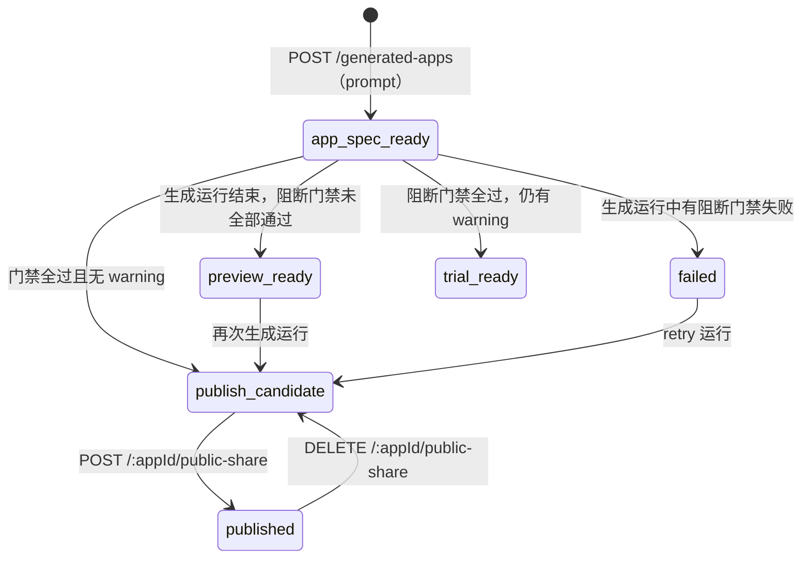

# 生成应用（服务端内部）

> 本页回答：一句自然语言需求在服务端经过哪些阶段才变成可公开访问的应用，代码按什么职责分层？

用户操作流程见 [生成应用](/guide/generated-apps/)，对外接入接口见 [生成应用 API](/api/generated-apps)。代码在 `agentloom-server/src/modules/generated-app/`。

## 生命周期

应用状态枚举 `generated_app_status` 为 `app_spec_generating`、`app_spec_ready`、`preview_ready`、`trial_ready`、`publish_candidate`、`published`、`failed`（`agentloom-server/src/database/schema/generated-apps.schema.ts`）。`app_spec_generating` 留给 v2 异步生成（[ADR-0007](/dev/decisions/0007-generated-app-spec-generation)）：应用已创建、`app_spec` 仍为 `null`。除 `published` 外，状态都由门禁结果计算得出（见下文「就绪度」）。

`app_spec` 列存 `GeneratedAppSpec = GeneratedAppSpecV1 | GeneratedAppSpecV2`（`types/generated-app.types.ts`，按 `version` 用 `isAppSpecV2()` 区分），v2 契约见 `types/app-spec-v2.schema.ts`。v1 是 ADR-0007 之前的模板规格，只剩存量数据：Gate 0 判它 `app-spec-legacy-template`，下一次生成运行会按需求重新生成；v1 公开运行时只服务 v1 规格的应用。迁移 `0089_generated_app_v2` 把存量 v1 应用的公开分享关闭、状态回到 `app_spec_ready`、`readiness` 置为 `blocked`。

### 1. 创建

`POST /api/v1/generated-apps` 接收 `prompt`，以及可选的 `modelConfigId`（本组织已启用的 chat 模型）与 `bindingTarget`（本组织已发布的工作流或 Agent）。两者在写入前按当前租户校验（外键不受 RLS 约束），分别存入 `generation_model_config_id` 与 `binding_target`，供生成运行解析模型与绑定目标。创建时不生成 AppSpec：应用以 `app_spec_generating` 状态写入，`app_spec` 为 `null`，名称取 prompt 第一句，Gate 0–7 全部 `pending`（`readiness` 为 `preview`、不能分享）。

### Gate 0：生成 AppSpec 与绑定解析

Gate 0 由 `GeneratedAppGate0Service.evaluate`（`generated-app-gate0.service.ts`）完成。AppSpec 缺失、是 v1 规格，或调用方要求重新生成（`regenerateAppSpec` / `triggerSource: 'retry'`）时调用模型生成；否则用 `GeneratedAppSpecV2Schema` 复核已存规格并重新解析绑定。读写库各用一个短租户事务，模型调用期间不持有事务。

生成由 `GeneratedAppSpecGeneratorService`（`generated-app-spec-generator.service.ts`）执行：

1. 模型：应用的 `generation_model_config_id`，否则租户默认 chat 模型；必须是已启用的 chat 模型。经 `PiAiAdapter.getModel` 实例化。
2. 候选：`GeneratedAppBindingResolverService.listCandidates`（`generated-app-binding-resolver.service.ts`）。指定了 `binding_target` 时只取该目标；否则取本租户最近更新的已发布工作流（排除 `metadata.generatedAppId` 非空的生成应用自建工作流）与已发布 Agent，合计最多 20 个。工作流候选带已发布版本快照的 `inputSchema` 与顶层 `text-output` / `json-output` 节点。
3. 调用：`OutputFormatService.executeStructuredOutput`，输出 schema 为 `z.toJSONSchema(GeneratedAppSpecDraftSchema, { io: 'input' })`，strict、允许降级到 L2。提示词在 `generated-app.app-spec-prompt.ts`：系统提示规定只能使用候选 id、字段 id 格式、每条需求给出可执行的浏览器步骤与具体填写值、高风险领域不设诊断/建议类字段；用户消息为 prompt 原文、候选目录 JSON（不超过 20 个、16KB，不含版本 id）与上一次的问题列表。
4. 校验：草稿 schema（含 `collectAppSpecReferenceIssues`）→ 绑定目标必须在候选目录中，固定为候选当前的已发布版本 → `resolve` 校验映射与固定版本快照兼容（见下）→ `buildAppSpecV2FromDraft`（`generated-app.app-spec.util.ts`）补平台需求 `req-platform-persist` 与平台场景、页面、数据策略、范围边界、traceability、生成元数据后整体用 `GeneratedAppSpecV2Schema` 复核。
5. 任一步有问题就把问题列表作为反馈重试，同一次 Gate 0 最多 `GENERATED_APP_SPEC_MAX_ATTEMPTS`（3）次。总超时 `APP_GENERATED_APP_SPEC_TIMEOUT_MS`（默认 120000）经 AbortSignal 取消模型调用。

通过后 `GeneratedAppRepository.saveGeneratedAppSpec` 写入 `app_spec`、名称、描述与实际使用的生成模型，`app_spec_generating` 进入 `app_spec_ready`。

绑定解析（`resolve`，Gate 4 复用）：目标存在、已发布，固定版本存在且未归档（源工作流重新发布不影响固定版本）。工作流绑定还要求：映射的输入是快照 `inputSchema` 中声明的字段；类型兼容（text/textarea→text、number→number、选择→同类型且选项是工作流选项的子集）；表单的 `maxLength`、`min`/`max` 不比工作流宽；每个必填输入都由必填字段映射；输出映射指向快照中的顶层 `text-output` / `json-output` 节点，`path` 只用于 `json-output`。工作流没有声明 `inputSchema` 时，映射键写入顶层 `inputParams`，不比对类型。

Gate 0 失败码写在 gate run 的 `failure.code`，`failure.details` 带问题列表；生成失败时另带模型配置 id、尝试次数、token 用量与模型输出前 2000 字符（去掉密钥形态的长串与宿主路径）：

| 失败码 | 含义 |
| --- | --- |
| `app-spec-model-unavailable` | 应用没有指定模型且租户没有默认 chat 模型，或指定的模型已删除、停用、不是 chat 模型 |
| `app-spec-binding-candidates-empty` | 没有可绑定的已发布工作流或 Agent，或创建时指定的目标已不可用 |
| `app-spec-model-output-invalid` | 模型连续 3 次输出不符合草稿 schema 或跨字段规则；复核已存规格不符合 v2 schema 时也用此码 |
| `app-spec-binding-invalid` | 绑定与目标不兼容（见上），或指定的工作流已发布版本没有输出节点 |
| `app-spec-generation-timeout` | 超过 `APP_GENERATED_APP_SPEC_TIMEOUT_MS` |
| `app-spec-legacy-template` | 已存规格是 v1 模板（复核已存规格时） |
| `app-spec-missing` | 已存规格为空（复核已存规格时；生成运行遇到空规格会先生成） |

### 2. 生成运行：门禁序列

`POST /api/v1/generated-apps/:appId/generation-runs/start` 在**请求内同步**执行一次生成运行（`GeneratedAppGenerationOrchestratorService.startGenerationRun`），参数：

| 字段 | 默认 | 范围 |
| --- | --- | --- |
| `triggerSource` | `manual` | `initial`、`manual`、`retry`、`system` |
| `maxRepairAttempts` | 3 | 0–20 |
| `maxRuntimeSeconds` | 1800 | 1–86400 |

运行记录写入 `generated_app_generation_runs`（状态 `queued` / `running` / `repairing` / `passed` / `failed` / `cancelled`），每个门禁的结果写入 `generated_app_gate_runs`（状态 `running` / `passed` / `failed` / `warning` / `skipped`）。门禁严格按序执行，前一个失败则停止：

| 门禁 | 名称 | 实现 |
| --- | --- | --- |
| `gate-0` | 需求规格门禁 | `GeneratedAppGate0Service`：按需生成 AppSpec v2，复核 schema 与绑定（见上文「Gate 0」） |
| `gate-1` | 架构计划门禁 | `buildGenerationPlan` 生成实现计划，校验其覆盖 AppSpec |
| `gate-2` | 静态合约门禁 | `buildStaticContracts`，校验 API 合约、图 schema、DAG、插件 manifest |
| `gate-3` | 构建与单元门禁 | `GeneratedAppGate3WorkspaceRunner`（`agentloom-server/src/modules/generated-app/generated-app.workspace.ts`）在本地工作区物化代码并执行命令计划 |
| `gate-4` | 集成门禁 | `GeneratedAppGate4IntegrationRunner` |
| `gate-5` | 浏览器验收门禁 | `GeneratedAppGate5BrowserAcceptanceRunner` |
| `gate-6` | 独立审查门禁 | `GeneratedAppGate6IndependentVerifierRunner` |
| `gate-7` | 发布候选门禁 | `GeneratedAppGate7PublishCandidateRunner` |

门禁定义（名称、是否阻断）的唯一来源是 `GENERATED_APP_GATE_DEFINITIONS`（`agentloom-server/src/modules/generated-app/generated-app.gates.ts`），当前全部为阻断门禁。各门禁的计划由 `agentloom-server/src/modules/generated-app/plan-builders/` 下的构建器生成。

门禁 3–7 的 runner 有 `real` / `fixture` / `disabled` 三种执行模式，默认 `real`，由各 runner 的 `getExecutorMode()` 经 `ConfigService` 读取 `GENERATED_APP_GATE<N>_EXECUTOR_MODE`。这些变量（以及 `GENERATED_APP_WORKSPACE_ROOT`、`GENERATED_APP_GATE3_COMMAND_TIMEOUT_MS`）在 `agentloom-server/src/config/env.schema.ts` 中声明，清单与默认值见 [配置参考](/deploy/configuration) 的 server 变量表。变量名不带 `APP_` 前缀，是因为 Gate 5 的证据中已持久化字面量 `GENERATED_APP_GATE5_EXECUTOR_MODE=real-browser-e2e`。

Gate 5 的 `real` 模式（`real-local-browser-contract`）只在服务端执行确定性的 DOM/无障碍/网络/console 契约，不启动浏览器；契约全部通过时仍返回 `failed`（`gate-5-real-browser-not-executed`），因为门禁定义是浏览器验收。`real-browser-e2e` 模式检查 `playwright` 包后也会 fail-closed（`gate-5-real-browser-e2e-unavailable` / `gate-5-real-browser-e2e-not-implemented`），服务端尚未接入 Playwright 执行适配层，server 镜像也不含 Playwright 与浏览器。只有显式的 `fixture` 模式会让 Gate 5 通过，仅用于测试。

`runGenerationToTerminal` 保证运行无论以何种方式退出都会落一个终态：未显式写入终态时，`finally` 中把运行标记为失败。

### 3. 修复

- **门禁内自动修复**：`gate-3` 失败且 `maxRepairAttempts > 0` 时，`GeneratedAppGenerationRepairService` 创建一条修复尝试（`generated_app_repair_attempts`，状态 `planned` / `running` / `completed` / `failed` / `skipped`），runner 应用修复补丁后重跑 `gate-3`。
- **失败运行的修复记录**：运行以失败结束时，记录一条自动修复尝试，供下一次运行使用。
- **retry 运行**：`triggerSource = 'retry'` 时，先读取最近一次失败的修复上下文，再据此构建生成计划。
- 修复尝试也可通过 `/:appId/generation-runs/:runId/repair-attempts` 手动管理。

### 4. 就绪度与预览

每次门禁结果写入后，`evaluateGeneratedAppReadiness` 重新计算 `readiness`，`getGeneratedAppStatusForReadiness` 据此更新应用状态：

| readiness.state | 条件 | 应用状态 | 可创建公开链接 |
| --- | --- | --- | --- |
| `blocked` | 有阻断门禁 `failed` | `failed` | 否 |
| `preview` | 有阻断门禁未通过但无失败 | `preview_ready` | 否 |
| `trial` | 阻断门禁全过，有 warning | `trial_ready` | 否 |
| `publish_candidate` | 全过且无 warning | `publish_candidate` | 是 |

创建者通过 `/:appId/artifacts` 查看生成产物（`GeneratedAppArtifactService`），通过 `/:appId/runtime-binding-readiness` 查看运行时绑定状态。

### 5. 运行时绑定

`gate-7` 通过后，`GeneratedAppRuntimeBindingService`（`agentloom-server/src/modules/generated-app/generated-app-runtime-binding.service.ts`）：

- 注册并激活通过门禁的**租户私有生成插件**（经 `PluginService`，见 [插件系统](/dev/server/plugins)）；
- 创建或复用一个已发布的工作流，作为应用的运行时，记在 `generated_apps.workflow_definition_id`。

生成运行不会自动创建公开链接。

### 6. 公开运行

- `POST /api/v1/generated-apps/:appId/public-share` 要求 `readiness.state = 'publish_candidate'`，生成 32 字节随机 hex token，把应用置为 `published`；`/public-share/regenerate` 换新 token，`DELETE` 停用并把状态退回由就绪度决定的值。
- 公开控制器 `GeneratedAppPublicController` 挂在 `/api/v1/generated-apps/public`，整体 `@Public()`，且该路径被排除在 `TenantMiddleware` 之外。按 token 查找应用时同时要求 `publicShareEnabled`、`status = 'published'` 且仍满足发布条件，任一不满足返回 404。
- 终端用户提交（`POST /public/:token/submissions`）的处理顺序：先按 AppSpec 生成的运行表单严格校验输入（不合法直接拒绝，而不是截断后接受）→ 本地运行时评估 → 评估完成且绑定了已发布工作流时，经 `ExecutionService.runWorkflow` 触发一次工作流执行 → 写入 `generated_app_submissions`（状态 `received` / `running` / `completed` / `failed`），记录匿名会话 id。创建者在 `/:appId/submissions` 查看提交。
- `generated_apps` 另有 Gate 5 验收令牌三列 `acceptance_token_hash`（只存 sha256，唯一索引）、`acceptance_token_expires_at`、`acceptance_generation_run_id`；`generated_app_submissions` 有 `origin`（`public` / `gate-acceptance`，默认 `public`）与 `generation_run_id`，`public_share_token` 对验收提交为 `null`。签发、按令牌取应用与验收提交的写入见 ADR-0007 §6。

## 代码分层

| 层 | 文件 | 职责 |
| --- | --- | --- |
| HTTP | `generated-app.controller.ts` | 认证路由（`GeneratedAppController`）与公开路由（`GeneratedAppPublicController`） |
| 门面 | `generated-app.service.ts` | 控制器唯一依赖的入口，把调用分派给下列服务 |
| 编排 | `generated-app-generation-orchestrator.service.ts` | 生成运行与门禁序列 |
| 修复 | `generated-app-generation-repair.service.ts` | 修复尝试的创建、完成与上下文解析 |
| 门禁 runner | `generated-app.workspace.ts`、`generated-app.integration-runner.ts`、`generated-app.browser-acceptance-runner.ts`、`generated-app.independent-verifier-runner.ts`、`generated-app.publish-candidate-runner.ts` | `gate-3` 至 `gate-7` 的执行 |
| 计划 | `plan-builders/*.builder.ts` | 各门禁的计划与评估函数 |
| 规则 | `generated-app.gates.ts`、`generated-app.app-spec.util.ts`、`generated-app.plan-validation.util.ts` | 门禁定义、就绪度计算、AppSpec 构造与校验（纯函数） |
| 产物 | `generated-app-artifact.service.ts` | 产物清单与内容读取 |
| 运行时 | `generated-app-runtime-binding.service.ts`、`generated-app.runtime.ts`、`generated-app.runtime-binding.util.ts` | 工作流/插件绑定、公开运行表单与本地评估 |
| 公开运行 | `generated-app-public-runtime.service.ts`、`generated-app-public-submission.util.ts`、`generated-app.public-sanitizer.util.ts` | 公开链接、提交、对外数据脱敏 |
| 持久化 | `generated-app.repository.ts` | 所有表读写；公开链接发布条件 `assertCanEnablePublicShare` |
| 类型与 DTO | `types/`、`dto/` | 领域类型与 Zod DTO |

表中文件均位于 `agentloom-server/src/modules/generated-app/` 下。相关表：`generated_apps`、`generated_app_generation_runs`、`generated_app_gate_runs`、`generated_app_repair_attempts`、`generated_app_submissions`，列定义见 [数据库](/dev/server/database)。
