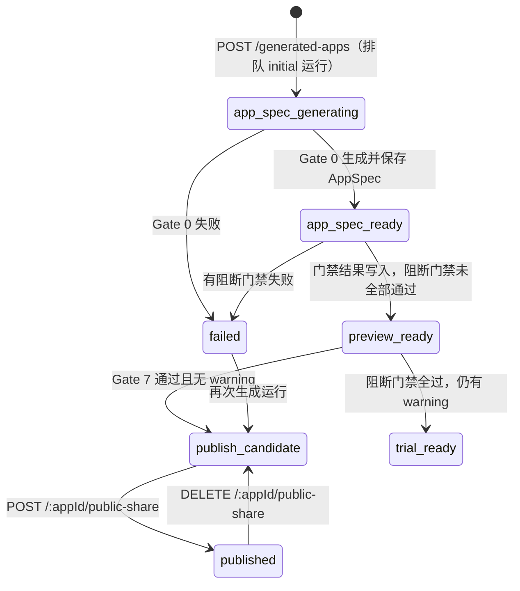

# 生成应用（服务端内部）

> 本页回答：一句自然语言需求在服务端经过哪些阶段才变成可公开访问的应用，代码按什么职责分层？

用户操作流程见 [生成应用](/guide/generated-apps/)，对外接入接口见 [生成应用 API](/api/generated-apps)，设计取舍见 [ADR-0007](/dev/decisions/0007-generated-app-spec-generation)。代码在 `agentloom-server/src/modules/generated-app/`。

## 生命周期

应用状态枚举 `generated_app_status` 为 `app_spec_generating`、`app_spec_ready`、`preview_ready`、`trial_ready`、`publish_candidate`、`published`、`failed`（`agentloom-server/src/database/schema/generated-apps.schema.ts`）。`app_spec_generating` 表示应用已创建、`app_spec` 仍为 `null`。除 `published` 外，状态都由门禁结果计算得出（见下文「就绪度」）。

`app_spec` 列只存 AppSpec v2（`types/app-spec-v2.schema.ts` 的 `GeneratedAppSpecV2Schema`）或 `null`。迁移 `0089_generated_app_v2` 关闭了存量 v1 应用的公开分享，`0090` 把 v1 的 `app_spec` 与 `generation_plan` 置空；这些应用的下一次生成运行由 Gate 0 按需求重新生成规格。

### 1. 创建

`POST /api/v1/generated-apps` 接收 `prompt`，以及可选的 `modelConfigId`（本组织已启用的 chat 模型）与 `bindingTarget`（本组织已发布的工作流或 Agent）。两者在写入前按当前租户校验（外键不受 RLS 约束）：模型不存在返回 `llm/config-not-found`、不是已启用的 chat 模型返回模型配置校验错误，绑定目标不存在或未发布返回 422 `generated-app-binding-target-not-found`。通过后分别存入 `generation_model_config_id` 与 `binding_target`，供生成运行解析模型与绑定目标。

创建时不生成 AppSpec：应用以 `app_spec_generating` 写入，`app_spec` 为 `null`，名称取 prompt 第一句，Gate 0–7 全部 `pending`（`readiness` 为 `preview`、不能分享）。随后 `GeneratedAppGenerationPipelineService.enqueueRun` 排队一次 `initial` 生成运行，201 响应在应用字段之外带 `generationRunId`，调用方用它轮询，不需要再调用 start。

### 2. 生成运行：排队与执行

`POST /api/v1/generated-apps/:appId/generation-runs/start` 只排队，返回 **202**：`generationRun.status = 'queued'`、`gateRuns` 为空数组、`app` 为当前应用。参数：

| 字段 | 默认 | 范围 |
| --- | --- | --- |
| `triggerSource` | `manual` | `initial`、`manual`、`retry`、`system` |
| `maxRepairAttempts` | 3 | 0–20 |
| `maxRuntimeSeconds` | 1800 | 1–86400 |
| `regenerateAppSpec` | `false` | `true` 时 Gate 0 丢弃已存规格重新生成；`triggerSource: 'retry'` 同样重新生成 |

`enqueueRun`（`generated-app-generation-pipeline.service.ts`）在一个租户事务内 `FOR UPDATE` 锁住应用行：已有 `queued` / `running` 运行时返回 409 `generated-app-generation-run-in-progress`；否则写入 `queued` 运行。事务提交后才把任务加入 BullMQ 队列 `generated-app-generation`（`generated-app-generation.constants.ts`：attempts 1、jobId 为运行 id、`removeOnComplete` 500 / `removeOnFail` 1000），入队失败时把运行标记为失败。

worker（`generated-app-generation.worker.ts`，并发 `APP_GENERATED_APP_GENERATION_CONCURRENCY`，默认 2）调用 `executeRun`：

1. 只认领 `queued` 运行（改为 `running`），重复投递直接跳过。
2. 按序执行 Gate 0–7，前一个失败即停止。每个 Gate 的读写各用一个短 `runInTenantTransaction`；模型调用与等待 Gate 5 的 browser-runner 时不持有事务。
3. 每个 Gate 结束时写一条 `generated_app_gate_runs`（`createGateRunAndUpdateApp` 同时重算应用的 `gate_results`、`readiness` 与状态），并把运行 `summary` 改为该 Gate 的结论。Gate 开始时不写记录，所以运行中的 Gate 由「第一个还没有记录的 Gate」推出（Studio 进度组件就这样显示）。
4. `maxRuntimeSeconds` 用 job 内的 AbortSignal 计时，超时取消当前 Gate。
5. `runGenerationToTerminal`（`generated-app-generation-terminal.util.ts`）保证运行无论以何种方式退出都会落终态：未显式写入终态时标记为失败，worker 的 `failed` 事件同样兜底，避免应用永远 409。

运行记录在 `generated_app_generation_runs`（`queued` / `running` / `repairing` / `passed` / `failed` / `cancelled`），门禁记录在 `generated_app_gate_runs`（`running` / `passed` / `failed` / `warning` / `skipped`）。调用方用 `GET /:appId/generation-runs/:runId` 与 `GET /:appId/gate-runs?generationRunId=` 轮询。

### Gate 0：生成 AppSpec 与绑定解析

Gate 0 由 `GeneratedAppGate0Service.evaluate`（`generated-app-gate0.service.ts`）完成。AppSpec 缺失，或调用方要求重新生成（`regenerateAppSpec` / `triggerSource: 'retry'`）时调用模型生成；否则用 `GeneratedAppSpecV2Schema` 复核已存规格并重新解析绑定。读写库各用一个短租户事务，模型调用期间不持有事务。

生成由 `GeneratedAppSpecGeneratorService`（`generated-app-spec-generator.service.ts`）执行：

1. 模型：应用的 `generation_model_config_id`，否则租户默认 chat 模型；必须是已启用的 chat 模型。经 `PiAiAdapter.getModel` 实例化。
2. 候选：`GeneratedAppBindingResolverService.listCandidates`（`generated-app-binding-resolver.service.ts`）。指定了 `binding_target` 时只取该目标；否则取本租户最近更新的已发布工作流（排除 `metadata.generatedAppId` 非空的生成应用自建工作流）与已发布 Agent，合计最多 20 个。工作流候选带已发布版本快照的 `inputSchema` 与顶层 `text-output` / `json-output` 节点。
3. 调用：`OutputFormatService.executeStructuredOutput`，输出 schema 为 `z.toJSONSchema(GeneratedAppSpecDraftSchema, { io: 'input' })`，strict、允许降级到 L2。提示词在 `generated-app.app-spec-prompt.ts`：系统提示规定只能使用候选 id、字段 id 格式、每条需求给出可执行的浏览器步骤与具体填写值、高风险领域不设诊断/建议类字段；用户消息为 prompt 原文、候选目录 JSON（不超过 20 个、16KB，不含版本 id）与上一次的问题列表。
4. 校验：草稿 schema（含 `collectAppSpecReferenceIssues`）→ 绑定目标必须在候选目录中，固定为候选当前的已发布版本 → `resolve` 校验映射与固定版本快照兼容（见下）→ `buildAppSpecV2FromDraft`（`generated-app.app-spec.util.ts`）补平台需求 `req-platform-persist` 与平台场景、页面、数据策略、范围边界、traceability、生成元数据后整体用 `GeneratedAppSpecV2Schema` 复核。
5. 任一步有问题就把问题列表作为反馈重试，同一次 Gate 0 最多 `GENERATED_APP_SPEC_MAX_ATTEMPTS`（3）次。总超时 `APP_GENERATED_APP_SPEC_TIMEOUT_MS`（默认 120000）经 AbortSignal 取消模型调用。

通过后 `GeneratedAppRepository.saveGeneratedAppSpec` 写入 `app_spec`、名称、描述与实际使用的生成模型，`app_spec_generating` 进入 `app_spec_ready`。

绑定解析（`resolve`，Gate 4 复用）：目标存在、已发布，固定版本存在且未归档（源工作流重新发布不影响固定版本）。工作流绑定还要求：映射的输入是快照 `inputSchema` 中声明的字段；类型兼容（text/textarea→text、number→number、选择→同类型且选项是工作流选项的子集）；表单的 `maxLength`、`min`/`max` 不比工作流宽；每个必填输入都由必填字段映射；输出映射指向快照中的顶层 `text-output` / `json-output` 节点，`path` 只用于 `json-output`。工作流没有声明 `inputSchema` 时，映射键写入顶层 `inputParams`，不比对类型。

Gate 0 失败码写在 gate run 的 `failure.code`，`failure.details` 带问题列表；生成失败时另带模型配置 id、尝试次数、token 用量与模型输出前 2000 字符（去掉密钥形态的长串与宿主路径）：

| 失败码 | 含义 |
| --- | --- |
| `app-spec-model-unavailable` | 应用没有指定模型且租户没有默认 chat 模型，或指定的模型已删除、停用、不是 chat 模型 |
| `app-spec-binding-candidates-empty` | 没有可绑定的已发布工作流或 Agent，或创建时指定的目标已不可用 |
| `app-spec-model-output-invalid` | 模型连续 3 次输出不符合草稿 schema 或跨字段规则；复核已存规格不符合 v2 schema 时也用此码 |
| `app-spec-binding-invalid` | 绑定与目标不兼容（见上），或指定的工作流已发布版本没有输出节点 |
| `app-spec-generation-timeout` | 超过 `APP_GENERATED_APP_SPEC_TIMEOUT_MS` |
| `app-spec-missing` | 已存规格为空（复核已存规格时；生成运行遇到空规格会先生成） |

### Gate 1–7

| 门禁 | 名称 | 实现 | 失败码 |
| --- | --- | --- | --- |
| `gate-1` | 架构计划门禁 | `generated-app.gate1-generation-plan.ts`：`planVersion: 2` 的覆盖矩阵（需求 → 场景 → 字段/结果分区 → 绑定），写入 `generation_plan` | `generation-plan-coverage-gap` |
| `gate-2` | 静态合约门禁 | `generated-app.gate2-static-contracts.ts`：由表单生成公开输入 JSON Schema、由结果分区生成结果合约，比对固定版本 `inputSchema`；Agent 绑定的包装工作流图经现有图结构校验 | `static-contract-mismatch` |
| `gate-3` | 构建与单元门禁 | `generated-app.gate3-workspace.ts`：在 `GENERATED_APP_WORKSPACE_ROOT` 下物化 `app-spec.ts`、`runtime-form.ts`、`static-contracts.ts`；对每个 requirement 场景执行真实的提交校验与 `inputSchema` 校验，另跑未知字段、缺必填字段两个拒绝用例 | `gate-3-workspace-materialization-failed` / `gate-3-command-failed` |
| `gate-4` | 集成门禁 | `generated-app.gate4-integration.ts`：复核目标仍发布、固定版本仍是当前版本、创建者角色可运行、Agent 的模型配置可用；Agent 绑定在这里创建并发布包装工作流（Gate 5 的提交经它执行），绑定已不可用时不创建 | `binding-drifted` / `binding-unavailable` |
| `gate-5` | 浏览器验收门禁 | `generated-app.gate5-browser-acceptance.ts` + `generated-app-browser-acceptance.dispatcher.ts`：签发验收令牌，把 requirement 场景投递给 browser-runner 在桌面与移动视口真实执行（见 ADR-0007 §6） | `gate-5-browser-runner-unavailable` / `gate-5-browser-runner-timeout` / `gate-5-browser-launch-failed` / `gate-5-scenario-failed` |
| `gate-6` | 独立审查门禁 | `generated-app.gate6-independent-verifier.ts`：确定性复核 Gate 5 证据——两个视口都通过、无 console error、无失败请求、结果分区非空、截图与 trace 在对象存储中存在 | `verifier-blocking-finding` |
| `gate-7` | 发布候选门禁 | `generated-app.gate7-publish-candidate.ts`：写 manifest（AppSpec sha256、固定绑定版本、各 Gate 证据 id、artifact key），调用 `ensureRuntimeWorkflow` 把运行时工作流写到应用上 | `gate-7-fixture-not-publish-candidate` / `gate-7-publish-candidate-contract-blocked` |

门禁定义（名称、是否阻断）的唯一来源是 `GENERATED_APP_GATE_DEFINITIONS`（`generated-app.gates.ts`），全部为阻断门禁。Gate 依赖经 `generated-app.v2-tokens.ts` 的 DI token 注入流水线。

Gate 3–7 的执行级别由 `GENERATED_APP_GATE<N>_EXECUTOR_MODE` 决定：未设置为 `real`，`fixture` 只用于单测，其他值一律按 `disabled` 处理（失败关闭，`generated-app.gate-v2.util.ts`）。Gate 5 在任何模式下都不会在未启动浏览器时判通过；`fixture` 的计划 `executionLevel` 为 `fixture`，Gate 6 不把它当作真实证据，Gate 7 对 fixture 直接失败。变量清单与默认值见 [配置参考](/deploy/configuration)。

写入门禁结果前有一道发布候选守卫（`applyPublishCandidateGuard`，`generated-app.gate7-publish-candidate.ts`）：readiness 将变为 `publish_candidate` 时，只有 `generation_plan` 里有 `real` 执行的 Gate 7 manifest、manifest 与计划属于同一次运行、指纹与当前 AppSpec 一致且运行时工作流已就绪，Gate 7 才算通过，否则改为 `failed`。经 `PATCH /:appId/gates` 手工记录的门禁结果同样经过这道守卫。

### 3. 修复

v2 不自动打补丁。运行以失败结束且 `maxRepairAttempts > 0` 时，`GeneratedAppGenerationRepairService.recordAutomaticRepairAttemptForFailedRun` 为第一个失败的 Gate 记一条修复尝试（`generated_app_repair_attempts`，状态 `planned` / `running` / `completed` / `failed` / `skipped`）：工单只给出失败证据、该 Gate 允许调整的范围与重新运行的验收标准。修复尝试也可通过 `/:appId/generation-runs/:runId/repair-attempts` 手动管理。要按调整后的需求重来，用 `triggerSource: 'retry'` 或 `regenerateAppSpec: true` 启动新运行。

### 4. 就绪度与交付物

每次门禁结果写入后，`evaluateGeneratedAppReadiness` 重新计算 `readiness`，`getGeneratedAppStatusForReadiness` 据此更新应用状态：

| readiness.state | 条件 | 应用状态 | 可创建公开链接 |
| --- | --- | --- | --- |
| `blocked` | 有阻断门禁 `failed` | `failed` | 否 |
| `preview` | 有阻断门禁未通过但无失败 | `preview_ready` | 否 |
| `trial` | 阻断门禁全过，有 warning | `trial_ready` | 否 |
| `publish_candidate` | 全过且无 warning | `publish_candidate` | 是 |

`/:appId/artifacts`（`GeneratedAppArtifactService`）按 `buildUnitPlan.workspace` 列出 Gate 3 物化的文件（`/:appId/artifacts/:artifactId` 读内容），并为 Gate 5 的截图与 trace 签发 15 分钟有效的预签名 `downloadUrl`（只签本应用本次运行 `gate-5` 前缀下的 key）。`/:appId/runtime-binding-readiness` 返回运行时绑定状态。

### 5. 运行时绑定

`GeneratedAppRuntimeBindingService`（`generated-app-runtime-binding.service.ts`）的 `ensureRuntimeWorkflow` 由 Gate 4（Agent 包装工作流）与 Gate 7 调用：

- 工作流绑定：直接使用被绑定工作流与 AppSpec 中的固定版本，不创建任何工作流。
- Agent 绑定：创建或复用本应用的包装工作流 manual-trigger → agent → text-output（`inputSchema` 由表单字段生成，metadata 标 `generatedAppId`）；图与当前 AppSpec 一致的已发布版本存在时原样返回，否则更新画布并经发布校验链发布新版本。

两种绑定都把运行时工作流写入 `generated_apps.workflow_definition_id`。绑定的工作流重新发布后，readiness 报 `workflow_version_drift`（提示，不阻断），应用仍执行固定版本。删除应用时，它自动创建的包装工作流一并归档。生成运行不会自动创建公开链接。

### 6. 公开运行

- `POST /api/v1/generated-apps/:appId/public-share` 要求 `readiness.state = 'publish_candidate'`，生成 32 字节随机 hex token，把应用置为 `published`；`/public-share/regenerate` 换新 token，`DELETE` 停用并把状态退回由就绪度决定的值。
- 公开控制器 `GeneratedAppPublicController` 挂在 `/api/v1/generated-apps/public`，整体 `@Public()`，且该路径被排除在 `TenantMiddleware` 之外。按 token 查找应用时先按公开分享令牌（同时要求 `publicShareEnabled`、`status = 'published'` 且仍满足发布条件），再按未过期的 Gate 5 验收令牌，都不满足返回 404。
- 终端用户提交（`POST /public/:token/submissions`）：按 AppSpec 表单严格校验输入（未知字段、类型、必填、长度、范围、选项，不合法直接拒绝）→ 按绑定投影为工作流输入 → `ExecutionService.runWorkflow` 以固定版本执行 → 写入 `generated_app_submissions`（状态 `received` / `running` / `completed` / `failed`，记录匿名会话 id）；执行结束后按 outputMapping 取步骤结果，公开脱敏后写入 `result.sections`。创建者在 `/:appId/submissions` 查看提交，默认排除 Gate 5 验收提交。
- `generated_apps` 的验收令牌三列 `acceptance_token_hash`（只存 sha256，唯一索引）、`acceptance_token_expires_at`、`acceptance_generation_run_id` 由 Gate 5 签发与撤销；验收令牌创建的提交 `origin = 'gate-acceptance'` 并记 `generation_run_id`，不计浏览量，见 ADR-0007 §6。

## 代码分层

| 层 | 文件 | 职责 |
| --- | --- | --- |
| HTTP | `generated-app.controller.ts` | 认证路由（`GeneratedAppController`）与公开路由（`GeneratedAppPublicController`） |
| 门面 | `generated-app.service.ts` | 控制器唯一依赖的入口，把调用分派给下列服务 |
| 编排 | `generated-app-generation-pipeline.service.ts`、`generated-app-generation.worker.ts`、`generated-app-generation.constants.ts`、`generated-app-generation-terminal.util.ts` | 排队、worker 执行 Gate 0–7、终态保护 |
| Gate 0 | `generated-app-gate0.service.ts`、`generated-app-spec-generator.service.ts`、`generated-app-binding-resolver.service.ts`、`generated-app.app-spec-prompt.ts` | AppSpec 生成与绑定解析 |
| Gate 1–7 | `generated-app.gate1-generation-plan.ts` 至 `generated-app.gate7-publish-candidate.ts`、`generated-app-browser-acceptance.dispatcher.ts`、`generated-app.gate-v2.util.ts`、`generated-app.v2-tokens.ts` | 各门禁的执行、执行级别与注入 |
| 修复 | `generated-app-generation-repair.service.ts` | 失败运行的修复工单 |
| 规则 | `generated-app.gates.ts`、`generated-app.app-spec.util.ts`、`generated-app.plan-validation.util.ts` | 门禁定义、就绪度计算、AppSpec 补全与校验（纯函数） |
| 产物 | `generated-app-artifact.service.ts` | 工作区文件清单与内容、Gate 5 截图/trace 预签名链接 |
| 运行时 | `generated-app-runtime-binding.service.ts`、`generated-app.runtime.ts`、`generated-app.runtime-binding.util.ts` | 运行时工作流、公开表单构建与提交校验、投影与结果抽取 |
| 公开运行 | `generated-app-public-runtime.service.ts`、`generated-app-public-submission.util.ts`、`generated-app.public-sanitizer.util.ts` | 公开链接、验收令牌、提交、对外数据脱敏 |
| 持久化 | `generated-app.repository.ts` | 所有表读写；公开链接发布条件 `assertCanEnablePublicShare` |
| 类型与 DTO | `types/`、`dto/` | 领域类型、AppSpec v2 与浏览器任务契约、Zod DTO |

表中文件均位于 `agentloom-server/src/modules/generated-app/` 下；browser-runner 进程在 `agentloom-server/src/modules/generated-app-browser-runner/`。相关表：`generated_apps`、`generated_app_generation_runs`、`generated_app_gate_runs`、`generated_app_repair_attempts`、`generated_app_submissions`，列定义见 [数据库](/dev/server/database)。
