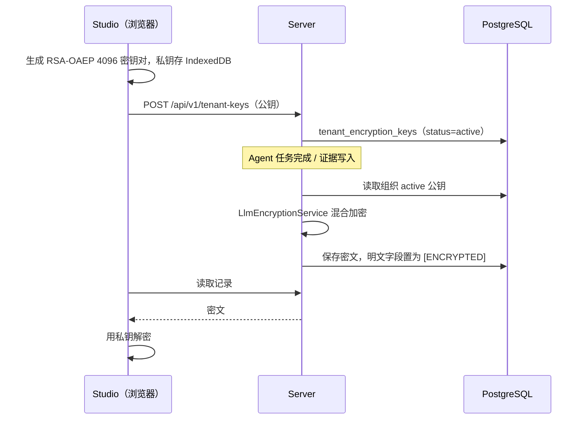

# 安全模型

> 本页回答：服务端用哪些机制识别调用者、隔离租户数据、保护密钥与敏感内容，每种机制的边界在哪里？

守卫与拦截器的执行顺序、限流算法见 [请求处理链路](/dev/server/request-pipeline)；本页只讲各机制本身。对外凭证的用法见 [API 与集成](/api/)。

## 调用者身份

服务端接受三种凭证，彼此不互相回退：

| 凭证                          | 传递方式                       | 校验位置                                                                                                                                                | 可访问范围                                      |
| ----------------------------- | ------------------------------ | ------------------------------------------------------------------------------------------------------------------------------------------------------- | ----------------------------------------------- |
| Supabase JWT                  | `Authorization: Bearer <jwt>`  | `AuthGuard`（HTTP）、`WsJwtGuard` 与各 gateway 握手中间件（Socket.IO）、`agentloom-server/src/modules/acp-gateway/acp-authentication.service.ts`（ACP） | 全部非公开路由                                  |
| 平台 API Token（`al_` 前缀）  | `X-Api-Key: al_…`              | `AuthGuard` 调用 `PlatformApiTokenService.validateToken`                                                                                                | 普通 REST 路由，按 token 的 scopes 与签发者角色 |
| Agent API Key（`alak_` 前缀） | `Authorization: Bearer alak_…` | `AgentApiKeyGuard`（`agentloom-server/src/modules/agent-api/agent-api-key.guard.ts`）                                                                   | 仅 `/api/v1/agent-api/*`                        |

请求带 `Bearer` 头时，`AuthGuard` 只走 JWT 分支；JWT 无效即返回 401，不会再尝试 `X-Api-Key`。`AuthGuard` 不识别 `alak_`：`/agent-api` 控制器声明 `@Public()` 跳过全局认证，再用自己的 `AgentApiKeyGuard`。

### JWT 校验与吊销

JWT 以 `APP_JWT_SECRET` 按 HS256 验签，要求 `aud=authenticated`。验签前先查吊销表：`TokenBlacklistService`（`agentloom-server/src/common/services/token-blacklist.service.ts`）把 token 的 SHA-256 哈希与过期时间写入数据库表 `revoked_tokens`，不使用 Redis。

GoTrue 签发的 access token 带 `session_id` 声明。带该声明的 token 在校验时，同一条 SQL 同时检查 `revoked_tokens`、`auth.sessions` 与 `auth.mfa_factors`：

- 会话行不存在或已过 `not_after` 即视为吊销（`token-revoked`）。因此 `DELETE /api/v1/auth/sessions/:id`、`POST /api/v1/auth/sessions/revoke-all`、GoTrue 侧登出与会话超时都会让该会话已签发的 access token 立即失效；`POST /api/v1/auth/logout` 另外把当前 token 写入 `revoked_tokens`。`session_id` 不是 UUID 或缺少 `sub` 时直接按吊销处理。
- 用户在 `auth.mfa_factors` 中有 `status = 'verified'` 的因子、而 token 的 `aal` 声明不是 `aal2` 时，拒绝为 403 `mfa-required`。仅凭密码拿到的 aal1 token（直连 GoTrue 登录，或 `mfa_pending` 临时令牌中携带的 aal1 token）因此无法访问业务接口。

上述表不可读（表不存在、权限不足、查询失败）时 fail-closed：返回 503 `https://agentloom.dev/errors/session-verification-unavailable`，不退化为只查哈希黑名单。应用的 `APP_DATABASE_URL` 必须能读到 GoTrue 的 `auth.sessions` 与 `auth.mfa_factors`。HTTP `AuthGuard`、Socket.IO 握手与 ACP 认证共用这一检查（`TokenBlacklistService.checkToken`）。

验签成功后，`UserIdentityResolver` 把 Supabase `sub` 换成应用内用户 ID，写入 `req.user`。

### MFA

用户绑定了已验证的 TOTP 因子时，`POST /api/v1/auth/login` 先签发 `type: 'mfa_pending'`、有效期 5 分钟的临时 JWT；客户端用它调用 `POST /api/v1/auth/mfa/login/verify` 换取 aal2 令牌。`AuthGuard`、`WsJwtGuard`、各 gateway 握手中间件和 ACP `authenticate` 都拒绝 `mfa_pending` 令牌，也拒绝已启用 MFA 用户的 aal1 令牌（见上文；HTTP 返回 403 `mfa-required`，Socket.IO 握手为 `MFA verification required`）。TOTP 绑定与解绑路由在 `agentloom-server/src/modules/auth/mfa.controller.ts`。

### OAuth

`POST /api/v1/auth/oauth/:provider` 发起登录，`provider` 取值为 `google` 或 `github`（`agentloom-server/src/modules/auth/dto/oauth.dto.ts`）；回调为 `GET /api/v1/auth/oauth/callback`，部署时由 `APP_OAUTH_REDIRECT_URL` 指向它。请求带 `platform=mobile` 时，回调结果以深链 `agentloom://auth/callback?…` 交给移动端，失败时为 `agentloom://auth/callback?error=oauth_callback_failed`（`agentloom-server/src/modules/auth/oauth.service.ts`、`agentloom-server/src/modules/auth/oauth.controller.ts`）。

## 平台 API Token

`agentloom-server/src/modules/platform-api-token/platform-api-token.service.ts`：

- 明文为 `al_` 加 32 字节随机数的 hex，只在创建响应中返回一次；数据库存 SHA-256 哈希，另存 `al_` 加 8 位的 `tokenPrefix` 供展示和限流识别。
- 每个用户在每个租户下最多持有 20 个未吊销的 token。
- 校验检查前缀、哈希、吊销标记与过期时间，角色从 `RbacCacheService` 读取，即 token 继承签发者当前的组织角色。
- `scopes` 只接受权限名（`agentloom-contracts/src/rbac.ts` 的 `PERMISSIONS`），空格或逗号分隔，词表外的值在创建时返回 422。留空（`null`）表示继承签发者角色的全部权限。限定了 scopes 的 token 由 `ApiScopeGuard`（`agentloom-server/src/common/guards/api-scope.guard.ts`，排在 `RolesGuard` 之后）检查：路由的 `@RequirePermission` 必须在 scopes 内；只声明 `@Roles` 的路由一律拒绝，返回 403 `insufficient-scope`。
- 管理路由前缀为 `/api/v1/platform-api-tokens`。

## Agent API Key

`agentloom-server/src/modules/agent-api/agent-api-key.service.ts`：明文为 `alak_` 加 32 字节随机数的 hex，存 SHA-256 哈希，`keyPrefix` 为 `alak_` 加 8 位；每个 Agent 最多 `MAX_ACTIVE_AGENT_API_KEYS_PER_AGENT`（20）个有效 key。管理路由为 `/api/v1/agent-definitions/:agentId/api-keys`。`AgentApiKeyGuard` 只在请求上挂 `agentApiKey`，不设置 `req.user`，因此这类请求不进入租户事务拦截器，服务层自行按 key 所属租户查询。

## RBAC 角色

组织角色与权限矩阵定义在 `agentloom-contracts/src/rbac.ts`（`ORG_ROLES`、`RBAC_PERMISSION_MATRIX`、`hasPermission`），server、Studio 与平台 API Token 的 scopes 共用；数据库枚举 `org_role` 取值 `owner`、`admin`、`creator`、`operator`、`viewer`。

- 路由用 `@RequirePermission(permission)` 声明所需权限，`RolesGuard` 取矩阵中该权限的角色集合判定；尚未迁移的路由仍用 `@Roles(...)` 列出角色。两者都是方法级覆盖类级，`@RequirePermission` 优先于 `@Roles`。角色之间**没有继承**，矩阵为每个权限显式列出允许的角色。
- 未声明 `@RequirePermission` 或 `@Roles` 的路由不经过 `TenantGuard` 与 `RolesGuard` 的检查：不要求 tenant，也不校验当前成员身份，租户只取 JWT claim。因此读写租户数据的路由必须声明其一（只读接口列出全部 5 个角色），被移出组织的成员持旧 JWT 访问时才会立即得到 403；仍未声明的路由只限用户级数据（`/auth/*`、`/devices/*`）、无租户引导流程（`POST /organizations`、`POST /invitations/:token/accept`）以及自带守卫的 `/evidence-exports/*`。决策见 [ADR 0010](/dev/decisions/0010-tenantless-request-db-fail-closed)。
- 每条路由的有效角色集合由 `agentloom-server/src/common/guards/__tests__/route-access.snapshot.spec.ts` 固定在快照中；放宽或收紧任何路由都要更新快照。
- 用户在组织中的角色由 `RbacCacheService`（`agentloom-server/src/common/services/rbac-cache.service.ts`）缓存在 Redis；未命中时查询 `organization_members` 关联 `organizations`。角色变更调用 `invalidateUserRole` 删除缓存并通过 Redis pub/sub 通知其他实例。
- ACP 网关（stdio，不走 HTTP 守卫）用 `AcpAccessService`（`agentloom-server/src/modules/acp-gateway/services/acp-access.service.ts`）做同一判定：`authenticate` 把 JWT 的 Supabase `sub` 映射为应用用户 id，除 `session/cancel` 外的 `session/*`、`terminal/*`、`fs/*` 每次调用都按 `agent:run` 经 `RbacCacheService` 校验，JWT 里的 `tenant_role` 声明不作数；`session/new` 的 `serverSandbox` 绑定目标须在本租户内存在，绑定工作流执行沙箱（`serverSandbox.executionId`）另需 `execution:control`。绑定对话（`serverSandbox.agentConversationId`）不要求属于本会话的 Agent：ACP 只接受 `no_sandbox` Agent，它自己的对话没有沙箱；调用者在 HTTP 侧凭 `agent:run` 已能向租户内任意对话发消息，绑定别的 Agent 的沙箱对话不会多给权限。见 [ACP 网关](/dev/server/acp#权限)。
- 成员管理在 `RolesGuard` 放行 owner / admin 之后，由 `OrganizationService`（`agentloom-server/src/modules/organization/organization.service.ts`）再按操作者在该组织中的角色校验：授予 owner、修改或移除 owner 成员只允许 owner（否则 403 `admin-cannot-grant-owner` / `admin-cannot-remove-owner`，邀请 owner 为 `admin-cannot-invite-owner`）；降级或移除最后一名 owner 返回 409 `sole-owner-constraint`。

## 数据库行级安全

租户隔离最终由 PostgreSQL RLS 保证，应用层的过滤条件只是第一道防线。

- 数据库函数 `get_tenant_id()` 定义为 `NULLIF(current_setting('app.current_tenant', true), '')::uuid`（迁移 `agentloom-server/src/database/migrations/0005_lazy_tomorrow_man.sql`；schema 侧引用在 `agentloom-server/src/database/schema/rls-helpers.ts`）。
- 策略工厂在 `agentloom-server/src/database/schema/rls-policies.ts`，策略都授予 `authenticated` 角色：
  - `createDirectTenantPolicies(table)`：select / insert / update / delete 四条策略，条件 `tenant_id = get_tenant_id()`。带 `tenant_id` 列的业务表默认使用它。
  - `createAppendOnlyTenantPolicies(table)`：只有 select / insert，用于 `audit_logs` 与 `audit_log_archives`。
  - `createJoinTenantPolicies(...)`：用于没有 `tenant_id` 列、通过父表关联判定租户的子表。
- 租户事务：`TenantTransactionInterceptor` 对带 tenant 的已认证请求开启事务，在事务内执行 `SET LOCAL ROLE authenticated` 与 `set_config('app.current_tenant', <tenantId>, true)`（`agentloom-server/src/common/interceptors/tenant-transaction.context.ts`）。事务提交后响应才发出。服务代码通过 `getTenantDb(this.db)` 取得当前事务连接。
- 无租户请求 fail-closed：已认证但 JWT 没有 tenant 的 HTTP 请求不开事务，处理器运行在无租户作用域（`tenantlessRequestStorage`）中，作用域内 `getTenantDb()`（`agentloom-server/src/common/providers/tenant-aware-db.provider.ts`）抛 400 `tenant-required`，不再回退到不受 RLS 约束的基础连接。确需无租户访问的服务（`OrganizationService.createOrganization`、`acceptInvitation`）显式使用注入的 `DRIZZLE` 基础连接，或用 `runInTenantTransaction` 显式进入某个租户。决策见 [ADR 0010](/dev/decisions/0010-tenantless-request-db-fail-closed)。
- 公开路由（没有 `request.user`）与不在请求链里的代码（BullMQ worker、定时任务、事件监听器、沙箱回调）不在上述作用域内，`getTenantDb()` 在事务外直接返回基础连接，不做角色切换，因此这类代码要么自行调用 `runInTenantTransaction`，要么在查询中显式带租户条件。

哪些表没有租户策略、迁移中 `GRANT` 的约定见 [数据库](/dev/server/database)。

## 端到端加密（E2EE）

E2EE 让数据库中保存的 LLM 输出与部分证据只有持有租户私钥的浏览器能解密。

- **算法**：`LlmEncryptionService`（`agentloom-server/src/modules/llm/llm-encryption.service.ts`）的算法标识为 `RSA-OAEP-4096+AES-256-GCM`。每次加密生成随机 32 字节 DEK 与 12 字节 IV，用 AES-256-GCM 加密明文，AAD 为 `<tenantId>:<timestamp>`；DEK 用租户公钥以 RSA-OAEP（SHA-256）加密。输出字段：`ciphertext`、`encryptedSessionKey`、`iv`、`authTag`、`aad`、`keyFingerprint`、`algorithm`。
- **加密范围**：`AgentTaskWorker` 加密 LLM 输出（`agentloom-server/src/modules/execution/agent-task.worker.ts`，`content` 置为 `[ENCRYPTED]`）；`EvidenceService` 只加密 `agent_decision` 与 `tool_output` 两类证据。`LlmEncryptionService.isE2EEEnabled` 为假（组织未配置公钥）时不加密。
- **公钥管理**（`agentloom-server/src/modules/tenant-key/`）：公钥至少 4096 位，拒绝私钥 PEM（`agentloom-server/src/modules/tenant-key/rsa-key-utils.ts`）；指纹为 SPKI DER 的 SHA-256。表 `tenant_encryption_keys` 状态为 `active` / `rotating` / `revoked`，组织 + 指纹唯一，部分唯一索引保证每个组织至多一个 `active`（`agentloom-server/src/database/schema/tenant-encryption-keys.schema.ts`）。已有 active key 时再次上传会被拒绝（409 `tenant-key-already-exists`），换钥走 `POST /api/v1/tenant-keys/:id/rotate`：只有 `active` key 可以轮换（`rotating` 返回 409 `tenant-key-not-active`，`revoked` 返回 409 `tenant-key-revoked`），旧 key 置为 `rotating`，新 key 成为 `active`。本组织登记过的公钥（含已轮换、已撤销的）不能再次上传或作为轮换目标，返回 409 `tenant-key-fingerprint-conflict`。服务先查重再写入，写入放在嵌套事务（savepoint）中，并发撞唯一索引时只回滚这一步并映射为上述 409。上传、轮换、删除要求 `owner` 或 `admin`；查询要求 `owner`、`admin`、`creator` 或 `operator`（`viewer` 不可）。
- **私钥**：Studio 在浏览器内生成密钥对，以 `extractable=false` 导入为 `CryptoKey` 后结构化克隆存入 IndexedDB（数据库 agentloom-keystore 的 private-keys 存储），页面脚本只能用它解密、无法导出字节；备份只在生成时下载 PEM（`agentloom-studio/src/features/tenant-key/lib/clientCrypto.ts`、`agentloom-studio/src/features/tenant-key/lib/keyStorage.ts`）。旧版保存 PKCS#8 字节的记录由 `migrateLegacyPrivateKeys` 在 Studio 启动时、以及 `getPrivateKey` 读取时迁移；导入或写回失败的记录原样保留并记 `console.error`，从不自动删除。私钥不上传服务端。

## 服务端密钥加密

LLM 提供商 API Key、MCP 服务凭据、私有部署配置中的密钥等**由服务端自己需要读取**的机密，使用信封加密，与租户 E2EE 无关：

- KEK 为 `APP_MASTER_ENCRYPTION_KEY`，必须是 Base64 编码的 32 字节值（`agentloom-server/src/config/env.schema.ts` 中有校验）。
- `EncryptionService`（`agentloom-server/src/modules/api-key/encryption.service.ts`）每条数据生成随机 DEK，用 AES-256-GCM 加密数据，再用 KEK 以 AES-GCM 加密 DEK。
- 调用方：`agentloom-server/src/modules/api-key/api-key.service.ts`、`agentloom-server/src/modules/mcp/mcp.service.ts`、`agentloom-server/src/modules/private-deployment/private-deployment.service.ts`。

更换 `APP_MASTER_ENCRYPTION_KEY` 会使已存密文无法解密。

## 服务端进程执行

stdio MCP 由 `McpService.createTransport`（`agentloom-server/src/modules/mcp/mcp.service.ts`）在 server / worker 进程所在的主机或容器内 spawn 用户填写的命令，测试、发现、导入、重新发现、把已保存配置改为 stdio（`updateConfig`）以及服务端代调的运行时工具调用都经过这一守卫。这等同于让 owner / admin 在服务端执行任意命令，而注册开放时任何用户都是自建组织的 owner，因此由 `APP_MCP_STDIO_ENABLED` 守卫、默认 `false`：未开启时直接抛 403 `mcp/stdio-disabled`，不创建进程。多租户部署必须保持关闭，只有单租户自托管且信任全部 owner / admin 时才开启。SSE 与 Streamable HTTP 传输不受影响。

有沙箱 Agent 的 stdio MCP 绑定不经过服务端：`SandboxAgentAdapter.createSession` 把它们作为 `mcpServers` 下发给 guest，由 dsh-mcp-client 在该会话的 microVM 内启动（见 [Agent 运行时](/dev/server/agent-runtime)），命令只能触及用户自己的沙箱，因此不受 `APP_MCP_STDIO_ENABLED` 约束；连接参数中的 env（含解密后的凭据）随会话进入 VM，与 workflow Agent 节点下发 MCP 的方式相同。无 sandbox Agent 在执行 stdio 绑定时被拒绝（`SandboxToolRegistryService.assertMcpTransportAllowed`）。

## Webhook 签名

入站 Webhook 的签名模式使用 HMAC-SHA256，签名串为 `<timestamp>.<rawBody>`，比较使用常数时间比较（`agentloom-server/src/modules/trigger/webhook.service.ts`）。请求头、容忍窗口和示例脚本见 [Webhook](/api/webhooks)。
