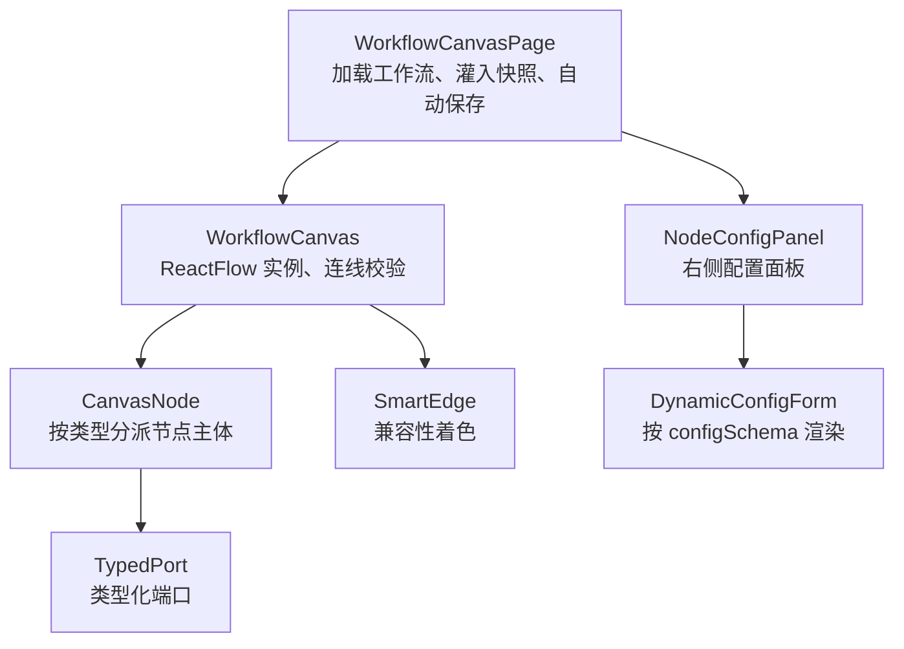
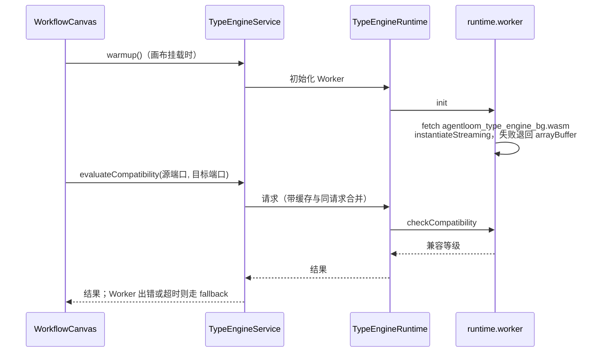

# 画布

工作流画布如何把节点注册表、本地草稿、自动保存与端口兼容性检查串在一起？本页解释 `agentloom-studio/src/features/canvas/` 的运行机制。节点类型本身的说明见 [节点参考](/guide/nodes/)。

## 节点从哪里来

画布上能放的节点由 `agentloom-studio/src/features/canvas/types/nodeTypeRegistry.ts` 决定：`NODE_TYPES` 是类型全集，`NODE_TYPE_REGISTRY` 为每个类型给出 label、描述、分类、输入/输出端口与配置项 schema；`DYNAMIC_ONLY_NODE_TYPES` 中的类型只在运行时生成，不出现在节点面板里。面板分组的名称与顺序来自 `agentloom-studio/src/features/canvas/components/nodeCategories.ts`。新增节点类型的步骤见 [新增节点类型](/dev/howto/add-node-type)。

## 组件结构

| 组件 | 文件 |
| --- | --- |
| `WorkflowCanvasPage` | `agentloom-studio/src/features/canvas/components/WorkflowCanvasPage.tsx` |
| `WorkflowCanvas` | `agentloom-studio/src/features/canvas/components/WorkflowCanvas.tsx` |
| `CanvasNode` | `agentloom-studio/src/features/canvas/components/CanvasNode.tsx` |
| `TypedPort` | `agentloom-studio/src/features/canvas/components/TypedPort.tsx` |
| `SmartEdge` | `agentloom-studio/src/features/canvas/components/edges/SmartEdge.tsx` |
| `NodeConfigPanel` | `agentloom-studio/src/features/canvas/components/panels/NodeConfigPanel.tsx` |
| `DynamicConfigForm` | `agentloom-studio/src/features/canvas/components/panels/DynamicConfigForm.tsx` |
| `agent` 节点专用面板 | `agentloom-studio/src/features/canvas/components/panels/AgentNodeConfigPanel.tsx` |
| 叠加层 | `agentloom-studio/src/features/canvas/components/overlays/` 下的 `CompatibilityPreview`、`ConnectionStateOverlay`、`NodeInfoCard` |

**细节层级**：`agentloom-studio/src/features/canvas/hooks/useLevelOfDetail.ts` 按缩放比例切换节点渲染精度：缩放 ≥ 0.7 为 full，0.4 到 0.7 为 compact，低于 0.4 为 minimal。节点越多、缩放越小，渲染的 DOM 越少。工作流画布与 Agent 画布的 `minZoom` 都是 0.1，大图 `fitView` 才能放下全部节点。compact / minimal 的卡片宽度限制不作用于展开的 Loop / Iteration 容器，容器尺寸始终由 `style` 决定。

## 画布草稿：canvasStore

`agentloom-studio/src/features/canvas/stores/canvasStore.ts` 中的 `useCanvasStore` 持有节点、边、视口、选中状态与 `isDirty` 标记，中间件由外到内为 `devtools`、`subscribeWithSelector`、`temporal`（zundo）、`immer`。它是画布的本地草稿，不是服务端数据的缓存：服务端版本由 TanStack Query 持有，草稿通过自动保存回写。

action 按职责分组（以 `CanvasActions` 接口为准）：

| 职责 | action |
| --- | --- |
| ReactFlow 变更 | `onNodesChange`、`onEdgesChange`、`createConnection`、`addNode`、`updateNodeData` |
| 删除与选择 | `deleteSelectedNode`、`deleteSelectedNodes`、`selectNode`、`selectNodes`、`toggleNodeSelection`、`clearSelection`、`selectEdge` |
| 封装为可复用块 | `applyEncapsulation`（由 `agentloom-studio/src/features/canvas/hooks/useEncapsulateSelection.ts` 在块保存成功后调用） |
| 连线字段映射 | `openFieldMapping`、`closeFieldMapping`、`updateEdgeData`、`updateFieldMapping`、`batchUpdateFieldMappings`、`saveMappingSnapshot`、`undoFieldMapping`、`refreshEdgeCompatibility` |
| 视口 | `setViewport`（不标脏）、`commitViewport`（标脏） |
| 与服务端同步 | `applyServerSnapshot`、`markSaved`、`advanceVersion`、`setIsSaving`、`reset` |
| 撤销与重做 | `undo`、`redo` |
| 搜索与辅助 | `toggleSearch`、`setSearchQuery`、`nextSearchResult`、`prevSearchResult`、`clearSearch`、`toggleMiniMap`、`setHoveredNodeId` |
| 布局 | `autoLayout`（整理全部节点位置，见下文「自动布局」） |
| 校验提示 | `setNodeValidationError`、`clearNodeValidationErrors` |

## 自动布局

> 本节回答：「整理布局」怎么排节点，为什么工作流画布与 Agent 画布共用一份实现？

通过 API 或 Agent 写入的画布，节点 `position` 由调用方给定，server 不校验也不重排，常见全部落在原点或互相重叠。`agentloom-studio/src/features/canvas/lib/autoLayout.ts` 的 `layoutCanvasNodes(nodes, edges)` 在客户端按真实节点尺寸重排，原地改写传入节点（可以是 immer draft）：

- **分层方向。** 端口左入右出，dagre 用 `rankdir: 'LR'`；节点尺寸取 React Flow 测量的 `measured`，未测量时回退 240×120。
- **两级布局。** 同一 `parentId` 下的兄弟节点为一组。展开的 Loop / Iteration 容器先在容器本地坐标里排子节点（原点为 `getCompoundInitialChildPosition`），再按内容包围盒加帧内距算出容器尺寸（不小于 `resolveCompoundContainerSize` 的下限），经 `writeCompoundNodeSize` 写回后调用 `syncCompoundParentLayout` 重建子节点 `extent`；之后容器作为一个整体参与外层布局。跨组的边提升到本组内的祖先节点参与排序。
- **不动不可见节点。** 收起容器的后代（`collectCollapsedCompoundDescendantIds`）保持原位，容器按收起尺寸参与布局。
- **锚定原位置。** 顶层布局平移到原顶层包围盒的左上角，避免内容跳到远处。

`useCanvasStore` 与 `useAgentCanvasStore` 都暴露 `autoLayout` action，在一次 `set` 中调用 `layoutCanvasNodes` 并标脏：工作流画布因此形成一个撤销步并走自动保存，Agent 画布需要用户点击「保存画布」。按钮由共用的 `CanvasBackdrop` 渲染在 React Flow `Controls` 中（传入 `onAutoLayout` 才显示，只读画布不传）。`measured` 随细节层级变化（compact 卡片约 156–180 宽，full 为 200–268），所以缩放低于 `LOD_FULL_THRESHOLD` 时按钮先 `zoomTo(1)` 并等两帧让 React Flow 按完整卡片重新测量，再布局，否则放大查看时会重叠；布局后下一帧 `fitView`。视口变化不进撤销历史，撤销仍只有一步。

**容器尺寸同步。** `agentloom-studio/src/features/canvas/lib/canvasStoreHelpers.ts` 的 `syncCompoundParentLayout` 在载入快照、增删子节点、改容器配置与 resize（含 React Flow 每次测量）后调用：收起态只固定宽度（360），去掉 `style.height` 与 `height`，高度由内容撑开——沿用展开时的大框会把收起卡片拉高、出边悬空、`fitView` 与小地图预留空白，写死高度则端口多时输出端口被裁到卡片外。收起分支不能删除 `measured`：它在每次测量后都会执行，删掉会让 React Flow 把节点当作未测量而隐藏并重新测量，形成循环。展开态取「当前尺寸」与「容纳全部子节点所需尺寸」（`computeMinResizeSize`）的较大值，因此从收起态展开时容器按子节点撑开，手动放大过的尺寸在一次收起 / 展开后不保留。展开态尺寸写入走 `writeCompoundNodeSize`，同时改 `style`、已存在的 `width` / `height` 与 `measured`：React Flow 渲染取 `width` / `height` 优先于 `style`，`readCompoundNodeDimension` 又优先读 `measured`，漏改任何一处旧尺寸都会盖过新尺寸。

收起 / 展开切换由 `updateNodeData` 识别 `config.isCollapsed` 的变化，改调 `applyCompoundCollapseToggle`：同步尺寸后按尺寸差平移同一父级下的节点——起点在容器原右边缘及以右的横移，横向与容器相交且位于原下边缘以下的纵移——展开不压住后面的节点，收起不留空白，来回切换位置可还原。收起一侧的尺寸两个方向都取 `resolveCompoundContainerSize` 的收起尺寸（高度按标题、端口区与摘要估算），不读 `measured`：收起瞬间内容尚未测量，而收起卡片的实测高度又随细节层级变化，两头混用估算与实测会让下方节点每轮漂移。为让这个估算就是实际高度，`CanvasNodeShell` 把它作为收起卡片的 `min-height`，卡片高度因此不随缩放变化。容器嵌套时再同步外层容器。

**只读预览。** 市场详情、模板向导与公开分享页的 `WorkflowPreviewCanvas` 不改快照、不能拖动，所以重叠由预览自己处理：`buildWorkflowPreviewGraph` 丢弃快照里保存时的 `measured`，按上述规则同步容器尺寸并隐藏收起容器内的节点与相连边。预览把节点放在本地 state，`onNodesChange` 只吸收 `dimensions` 变更（不吸收时节点上永远拿不到真实尺寸）；全部可见节点测量完成后，`hasOverlappingSiblings` 判断同一父级下的可见节点是否相交，相交才对副本调用 `layoutCanvasNodes` 并重新 `fitView`，不重叠的快照保留作者的布局。测量期间预览强制 full 细节层级，布局按完整卡片尺寸留间距。

## 自动保存

`agentloom-studio/src/features/canvas/hooks/useAutoSave.ts` 订阅 store 的节点、边、视口与 `isDirty`，防抖 `AUTOSAVE_DEBOUNCE_MS` 毫秒后调用 `useUpdateWorkflow`，即 `PATCH workflow-definitions/:id`，请求体为 `{ nodes, edges, viewport, version }`，字段保持 camelCase。防抖时长取 `VITE_AUTOSAVE_DEBOUNCE_MS`，空值、非正数或镜像内未替换的占位符回退 2000。

- 请求带上当前 `version`，server 用它做乐观并发控制。
- 成功后，若保存期间没有新的编辑，调用 `markSaved(version)` 清除脏标记；若有新编辑，只调用 `advanceVersion(version)` 推进版本号，让下一次保存不因版本落后被拒。
- 失败时提示「自动保存失败」或「自动保存失败，修改已保留在本地」，草稿不丢。
- 已归档的工作流不自动保存。

`VITE_AUTOSAVE_DEBOUNCE_MS` 经 `agentloom-studio/src/shared/lib/runtimeEnv.ts` 的 `readRuntimeEnv` 按变量名读取。直接写 `Number(import.meta.env.VITE_AUTOSAVE_DEBOUNCE_MS)` 会让压缩器在构建期把镜像占位符折叠成常量，容器启动时的替换因此失效。新增运行时变量同样走 `readRuntimeEnv`。

## 撤销与重做

> 本节回答：哪些编辑会进入历史栈，为什么撤销不会和服务端版本冲突？

`useCanvasStore` 用 zundo 的 `temporal` 维护历史栈，`useCanvasStore.temporal` 是独立的历史 store，组件通过 `useCanvasHistory()` 读取 `canUndo` / `canRedo`。

- **只记录图结构。** `partialize` 只取 `nodes` 与 `edges`，并去掉 React Flow 写在元素上的交互态 `selected`、`dragging`、`resizing`。视口、选中、`isDirty`、`version`、保存状态与校验提示都不进历史。`equality` 逐元素比较，忽略 React Flow 测量出的 `measured`，所以选中、尺寸测量、`markSaved` / `setIsSaving` 这类变更不产生历史步。
- **一次拖拽一步。** 节点拖拽或缩放期间（store 中有节点 `dragging` 或 `resizing` 为 `true`），`handleSet` 只记下手势开始前的图，不提交中间帧；手势结束（React Flow 发出 `dragging: false` 的位置变更）时把开始前的图作为一步提交，位置没变则不提交。
- **派生更新并入上一步。** `refreshEdgeCompatibility` 是类型引擎对已有连线的异步重算，在暂停跟踪（`pause` / `resume`）下写入，不单独成为一步。
- **加载即清空。** `applyServerSnapshot` 与 `reset` 在暂停跟踪下写入，然后清空历史，因此历史不会跨越服务端版本；撤销只会回到本次加载之后的编辑。
- **跳转后照常保存。** `undo` / `redo` 恢复图结构后清空选中、关闭指向已不存在连线的映射面板，并把 `isDirty` 置为 `true`，由自动保存按正常路径回写。历史上限 `CANVAS_HISTORY_LIMIT` 为 100 步。

快捷键在 `agentloom-studio/src/features/canvas/hooks/useCanvasKeyboardShortcuts.ts`：Ctrl/Cmd+Z 撤销，Shift+Ctrl/Cmd+Z 与 Ctrl+Y 重做；只读画布、焦点在 input / textarea / select / contenteditable 内时不拦截。字段映射面板打开时 Ctrl/Cmd+Z 让给 `useFieldMappingInteractions`，撤销的是 `fieldMappingUndoStack` 中的映射编辑。工具栏 `VersionToolbar` 的「撤销」「重做」按钮在历史为空时禁用。

## 服务端快照与本地草稿

`WorkflowCanvasPage` 只在工作流 id 或 `version` 与 store 中不同时调用 `applyServerSnapshot` 覆盖草稿。如果是同一个工作流且画布有未保存修改，它跳过服务端快照并提示「已保留本地未保存修改」。这样，自动保存成功后 TanStack Query 写回的数据不会把用户在保存期间做的编辑冲掉。

## 可复用块：封装与执行态

右键「封装为可复用块」由 `useEncapsulateSelection` 驱动：`agentloom-studio/src/features/canvas/lib/encapsulation.ts` 的 `resolveEncapsulationSelection` 校验选区（至少两个同层节点，容器连同子节点），`analyzeEncapsulation` 从跨越选区边界的连线派生块端口，`BlockCreateDialog` 编辑名称与端口后 `POST /reusable-blocks` 保存，成功后 `replaceNodesWithBlock` 生成的图经 `applyEncapsulation` 写回草稿。块节点在 `data.blockDefinition` 中内嵌一份定义，server 运行时据此展平（见 [核心概念](/dev/concepts#dag-调度)）。

展平后块节点本身没有执行步骤，块内步骤的 `nodeId` 为 `<blockNodeId>::<innerId>`。`useNodeExecutionState(blockNodeId)` 在没有直接条目时，用 `agentloom-studio/src/features/execution/lib/reusableBlockState.ts` 的 `aggregateReusableBlockState` 按前缀聚合内部步骤状态；执行高亮用 `toCanvasNodeId` 把内部步骤映射回块节点。

## 连线兼容性检查

拖出连线时，画布需要立刻知道两个端口能否相连。检查在 Web Worker 里的 WASM 中完成，主线程不阻塞，也不请求 server：

| 文件 | 作用 |
| --- | --- |
| `agentloom-studio/src/features/canvas/lib/typeEngine/service.ts` | `TypeEngineService`：`warmup`、`getCachedCompatibility`（同步读缓存）、`evaluateCompatibility`（异步，异常时退回 fallback） |
| `agentloom-studio/src/features/canvas/lib/typeEngine/runtime.ts` | 创建 Worker、结果缓存、同请求合并、请求超时 4000 毫秒 |
| `agentloom-studio/src/features/canvas/lib/typeEngine/runtime.worker.ts` | 加载 `agentloom-type-engine/pkg/agentloom_type_engine_bg.wasm` 并调用 `checkCompatibility` |
| `agentloom-studio/src/features/canvas/lib/typeEngine/contracts.ts` | 主线程与 Worker 之间的消息类型、序列化后的端口定义 |
| `agentloom-studio/src/features/canvas/lib/typeEngine/serialize.ts` | 把画布端口序列化为 WASM 的输入 |
| `agentloom-studio/src/features/canvas/lib/typeEngine/fallback.ts` | Worker 不可用时的兜底判断，规则取自 `@agentloom/contracts` 的 `PORT_DATA_TYPE_TRANSFORM_RULES` |
| `agentloom-studio/src/features/canvas/lib/connectionCompatibility.ts` | 画布侧入口：同步读缓存结果供拖线高亮，异步评估供落线校验 |

兼容等级与转换规则见 [类型引擎](/dev/type-engine)。
